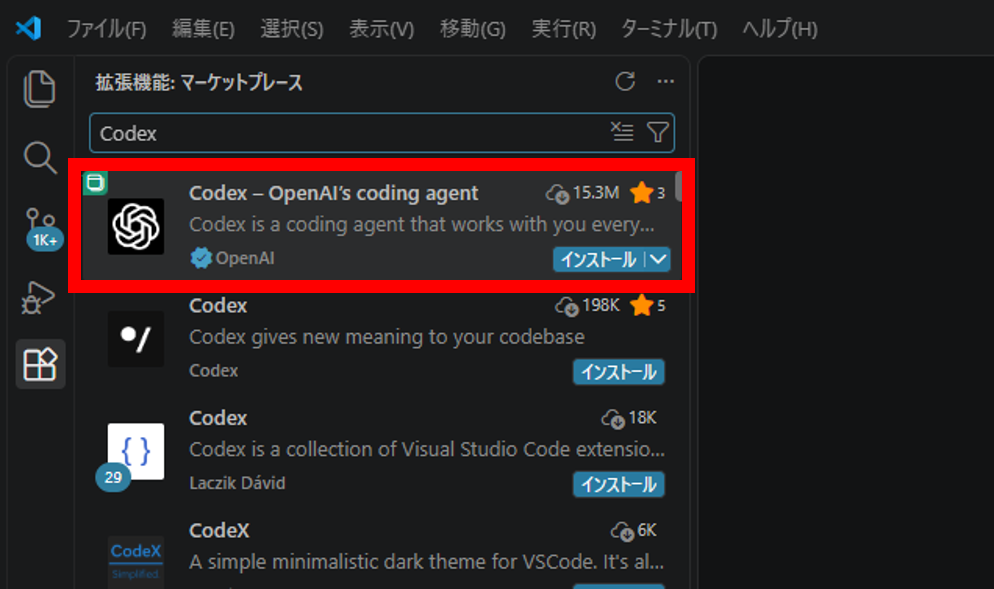
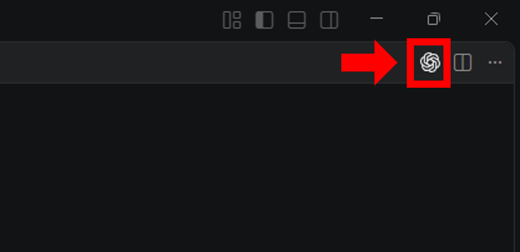
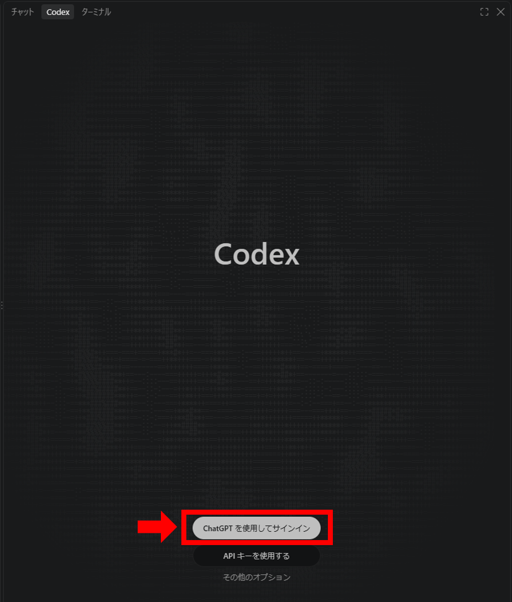
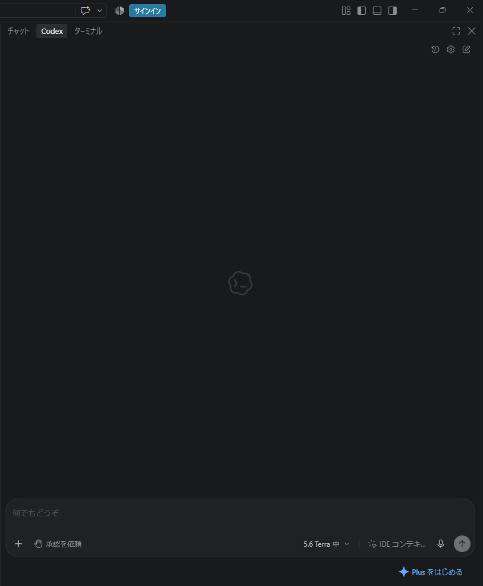
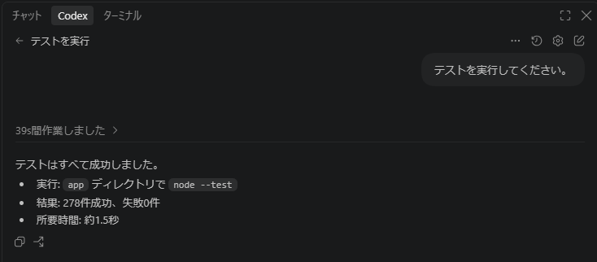

# AIエージェント入門　環境構築ガイド

10月15日（木）の勉強会で、実際にAIエージェントを動かしていただく時間があります。
当日までに、お手元のPCで環境構築をお願いします。

**所要時間：15〜20分程度**

このページはスマートフォンでもご覧いただけます。PCで作業しながら手順をご確認ください。

### 手順の流れ

| | 内容 |
|---|---|
| 1 | 使用するPCとアカウントを用意する |
| 2 | VSCodeをインストールする |
| 3 | Codex拡張機能をインストールする |
| 4 | ChatGPTアカウントでサインインする |
| 5 | Node.jsをインストールする |
| 6 | このリポジトリを取得する |
| 7 | 動作確認をする |

---

## 1　使用するPCとアカウントを用意する

**【推奨】私物PC ＋ 個人のChatGPTアカウント**

ChatGPTの無料プランで利用できます。

- 業務データ・顧客情報は入力しないでください
- 生成物を業務の成果物としては使用しないでください

手順4でこのアカウントを使ってサインインします。
**お持ちでない方は、先に https://chatgpt.com/ でアカウントを作成しておいてください。**
メールアドレスのほか、Google・Microsoft・Appleのアカウントでも作成できます。

**会社発行のChatGPT Businessアカウントをお持ちの方**

会社貸与PCでそのアカウントを使う形でも構いません。

※会社貸与PCをお使いの場合は、所属先のルールをご確認ください。

---

## 2　VSCodeのインストール

すでにお使いの方は 3 へ進んでください。

1. https://code.visualstudio.com/ を開く
2. お使いのOS向けのインストーラーをダウンロードして実行
3. 設定はすべて既定のままで問題ありません

---

## 3　Codex拡張機能のインストール

VSCodeの拡張機能で `Codex` と検索し、OpenAI提供の拡張機能をインストールしてください。



インストール完了後に画面右上に追加されるアイコンからCodexのパネルを開きます。



---

## 4　ChatGPTアカウントでサインイン

**「ChatGPT を使用してサインイン」** を選択し、ブラウザで手順1のアカウントにログインしてください。



この画面になれば完了です。



---

## 5　Node.jsのインストール

当日のハンズオンで使用します。**Node.js 22以降**が必要です。

1. https://nodejs.org/ を開く
2. **LTS版**をダウンロードしてインストール（設定はすべて既定のままで問題ありません）
3. VSCodeのメニューから「ターミナル」→「新しいターミナル」を開き、次を実行

```
node --version
```

`v22` 以降が表示されればOKです。

すでにNode.jsをお使いの方も、バージョンが22未満の場合は入れ直してください。

---

## 6　リポジトリの取得

**Gitをお使いの場合**

```
git clone https://github.com/furuya-seiko/agent-handson.git
```

**Gitをお使いでない場合**

https://github.com/furuya-seiko/agent-handson を開き、
緑色の「Code」ボタン →「Download ZIP」からダウンロードして、
任意の場所に展開してください。

取得したフォルダを、VSCodeの「ファイル」→「フォルダーを開く」から開いてください。

中身は当日に確認しますので、事前に読み込む必要はありません。

---

## 7　動作確認

Codexのパネルに、次のように入力してください。

```
テストを実行してください。
```

Codexがテストを実行します。
**278件すべてが成功すれば準備完了です。**



ファイルへのアクセスやコマンドの実行許可を求められた場合は、許可して進めてください。

---

## 当日までのお願い

**Codexの利用枠を使い切らないようご注意ください。**

無料プランには利用上限があり、上限に達すると復帰まで最大5時間かかります。
動作確認以上に使い込むと、当日に動かせなくなる可能性があります。
